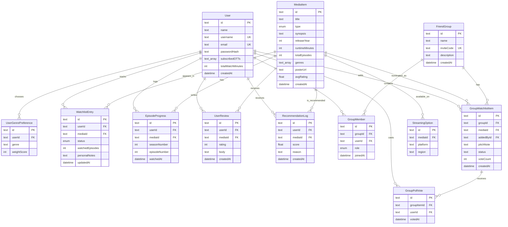

# 2. ER Diagram and Data Model

## Entity relationship diagram

## Relationships

- **One-to-one:** no direct optional single-row pair is required. The unique `(userId, mediaId)` reviews and watchlist entries act as one current entry per user/media pair.
- **One-to-many:** a user has many watchlist entries, reviews and preferences; a media title has many reviews and streaming options.
- **Many-to-many:** users and media are linked by watchlists and reviews. Users and friend groups are linked by `GroupMember`; users and group nominations are linked by `GroupPollVote`.
